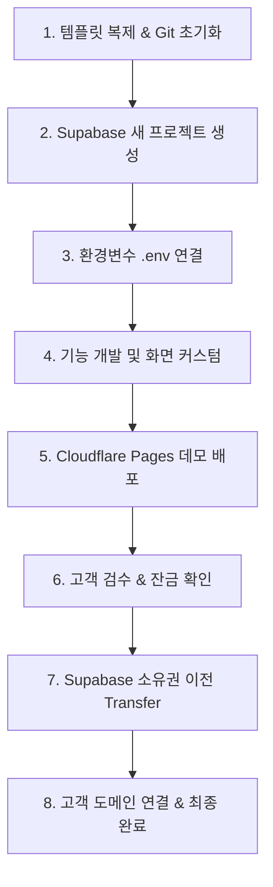

# 🚀 새 외주 개발 시작 시 리마인드 개발 가이드 (New Project Quickstart)

> **"새로운 외주 프로젝트가 들어왔을 때 이 문서 하나만 보고 그대로 따라 하시면 됩니다."**  
> 본 가이드는 **Cloudflare Pages(무료 무제한 호스팅) + Supabase(관계형 DB/인증) + Next.js / PySide6** 아키텍처를 기반으로 외주 개발을 시작부터 납품, 사후 유지보수까지 진행하는 실전 개발자 치트시트입니다.

---

## 🧭 1. 외주 개발 핵심 공식 리마인드 (Cost 0 KRW)

| 영역 | 채택 기술 | 운영 및 계정 전략 |
| :--- | :--- | :--- |
| **웹 프론트** | **Next.js 14 + Tailwind** | **내 Cloudflare Pages 계정**에 배포하고 고객 도메인만 CNAME 연결 (비용 0원, 무제한 트래픽) |
| **백엔드/DB** | **Supabase (PostgreSQL)** | 내 계정에서 개발 후, 납품 시 **고객 계정으로 Transfer(이전)** -> **내 이메일을 Developer 멤버로 등록** |
| **PC 앱 (선택)** | **PySide6 (Python)** | 단일 `.exe` 패키징 + GitHub Releases 또는 Cloudflare R2에 릴리즈 에셋 호스팅 |

---

## ⚡ 2. 새 외주 프로젝트 진행 8단계 실전 워크플로우



### [Step 1] 프로젝트 폴더 복제 & Git 초기화 (3분)
1. 기존 템플릿 폴더를 새 외주 프로젝트명(예: `client-project`)으로 통째로 복사합니다.
2. 기존 Git 이력을 초기화하고 새 고객사 레포지토리를 연결합니다:
   ```bash
   cd client-project
   rmdir /s /q .git
   git init
   ```

### [Step 2] Supabase 새 프로젝트 생성 (2분)
1. [Supabase 대시보드](https://supabase.com/dashboard)에 내 계정으로 로그인합니다.
2. **`New project`** 클릭:
   - Name: `고객사프로젝트명`
   - Database Password: 강력한 비밀번호 설정 (메모 필수)
   - Region: `AWS Seoul (ap-northeast-2)` 또는 `Mumbai (ap-south-1)` 선택 (무료)
3. **`Project Settings` -> `API`**에서 아래 2개 값을 복사합니다:
   - `Project URL`
   - `anon public key`

### [Step 3] 환경변수(.env) 설정 (1분)
- **웹 클라이언트 (`web/.env.local`)**:
  ```env
  NEXT_PUBLIC_SUPABASE_URL=https://[프로젝트ID].supabase.co
  NEXT_PUBLIC_SUPABASE_ANON_KEY=[복사한_anon_key]
  ```
- **데스크톱 앱 (`desktop/.env`)**:
  ```env
  SUPABASE_URL=https://[프로젝트ID].supabase.co
  SUPABASE_ANON_KEY=[복사한_anon_key]
  ```

### [Step 4] 기능 개발 및 로컬 테스트
- 웹 개발 서버 실행:
  ```bash
  cd web
  npm install
  npm run dev
  # -> http://localhost:3000 에서 확인
  ```
- 데스크톱 앱 실행 (필요 시):
  ```bash
  cd desktop
  python main.py
  ```

### [Step 5] Cloudflare Pages 데모 배포 (2분)
고객에게 개발 중간 과정을 보여주기 위한 데모 배포입니다:
```bash
cd web
npm run build
npx wrangler pages deploy out --project-name=client-demo --branch=master
```
- 터미널에 출력되는 `https://client-demo.pages.dev` 주소를 고객에게 카톡/메일로 전달하여 피드백을 받습니다.

### [Step 6] 고객 검수 & 잔금 입금 확인
- 모든 기능 테스트 완료 후, **소유권을 넘기기 전에 반드시 개발 잔금 입금을 확인**합니다.

### [Step 7] Supabase 소유권 이전 (Transfer) & 내 권한 유지 (3분)
1. 고객에게 구글 계정으로 [Supabase](https://supabase.com)에 무료 가입하라고 안내합니다.
2. 내 Supabase 대시보드 -> 해당 프로젝트 -> **`Settings (톱니바퀴)`** -> **`General`**
3. 화면 최하단 **`Transfer project`** 클릭 -> 고객의 Supabase 계정 이메일 입력 후 전송.
4. 고객이 이메일에서 **[Accept Transfer]** 버튼 클릭!
   - 👉 **내 계정의 무료 프로젝트 슬롯(2개 한도)이 즉시 비워집니다.**
5. **[매우 중요 ⭐] 사후 유지보수를 위한 내 계정 멤버 등록**:
   - 고객에게 Supabase 대시보드의 **`Organization Settings` -> `Members`**에서 **내 개발자 이메일을 Member(Developer 또는 Admin)로 초대**해달라고 요청합니다.
   - 이렇게 해두면 나중에 고객 로그인 정보를 묻지 않고도 내 계정으로 로그인하여 언제든 DB를 고칠 수 있습니다!

### [Step 8] 고객 구매 도메인 연결 (2분)
고객이 가비아/후이즈 등에서 도메인(예: `www.client.com`)을 구매해왔다면:
1. 내 Cloudflare Pages 대시보드 -> 해당 프로젝트 선택
2. **`Custom domains`** -> **`Set up a custom domain`** 클릭
3. `www.client.com` 입력
4. 가비아 DNS 설정 페이지에서:
   - 타입: `CNAME`
   - 호스트: `www`
   - 값/위치: `client-demo.pages.dev`
5. 저장하면 5분 내로 Cloudflare가 무료 SSL 보안인증서(`https://`)를 자동 발급하고 연결 완료됩니다!

---

## 🛠️ 3. 사후 유지보수(수정 요청) 발생 시 30초 대응 공식

고객이 몇 달 뒤 기능 수정이나 텍스트 변경을 요청했을 때의 초간단 작업법입니다:

### 1) 웹 화면 / 프론트엔드 수정 요청 시
```bash
# 1. 내 컴퓨터에서 코드 수정
# 2. 빌드 및 배포
cd web
npm run build
npx wrangler pages deploy out --project-name=client-demo --branch=master
```
👉 **명령어 실행 후 30초 안에 고객 사이트에 즉시 반영 완료!**

### 2) 데이터베이스 구조 변경 요청 시 (새 컬럼/테이블 추가)
1. 내 Supabase 계정으로 로그인합니다 (이미 Step 7에서 멤버로 등록되어 있으므로 고객 프로젝트가 대시보드에 보입니다).
2. **`SQL Editor`**를 엽니다.
3. 필요한 SQL 명령을 실행합니다:
   ```sql
   -- 예: 새 컬럼 추가 (무중단 실시간 반영)
   ALTER TABLE public.customers ADD COLUMN IF NOT EXISTS birthday DATE;
   ```
👉 **기존 데이터 손실이나 서비스 중단 없이 실시간 0.1초 만에 반영 완료!**

---

## ⚠️ 4. 절대 잊지 말아야 할 실수 방지 팁 (Pitfalls & Gotchas)

1. **Cloudflare Pages는 정적 파일 25MB 제한이 있습니다.**
   - 웹사이트는 용량이 작아서 전혀 문제없지만, PC용 `.exe` 파일(약 70MB)은 Pages에 직접 올리면 빌드가 거부됩니다.
   - PC 설치 파일은 **GitHub Releases** 또는 **Cloudflare R2**(오브젝트 스토리지, 10GB 무료)에 올려서 다운로드 링크로 연결하세요.
2. **Supabase RLS(행 수준 보안)를 켰다면 반드시 Policy를 추가하세요.**
   - `ALTER TABLE customers ENABLE ROW LEVEL SECURITY;`만 실행하고 정책(`CREATE POLICY`)을 안 만들면, 관리자라도 API 조회가 빈 배열(`[]`)로 나옵니다.
   - 항상 `CREATE POLICY "Allow authenticated full access"` 정책을 함께 적용하세요.
3. **PyInstaller 6+ 패키징 시 환경변수 격리 필수:**
   - PC 앱 자동 업데이트 스크립트를 작성할 때는 반드시 `$env:_PYI_APPLICATION_HOME_DIR = $null`로 임시 경로 환경변수를 비워주어야 새 프로세스가 DLL 로드 에러(0x7e) 없이 재시작됩니다.
4. **Cloudflare 배포 시 프로젝트명 중복 주의:**
   - `wrangler pages deploy` 실행 시 `--project-name`은 영문 소문자와 하이픈(`-`)만 사용하세요.

---

## 📁 5. 참고 링크 모음
- [Supabase 공식 대시보드](https://supabase.com/dashboard)
- [Cloudflare Pages 공식 대시보드](https://dash.cloudflare.com)
- [전체 프로젝트 통합 기술 문서 (PROJECT_DOCS.html)](file:///c:/project/mini-salon/PROJECT_DOCS.html)
- [외주 실전 운영 가이드 (OUTSOURCING_TEMPLATE_GUIDE.md)](file:///c:/project/mini-salon/OUTSOURCING_TEMPLATE_GUIDE.md)
