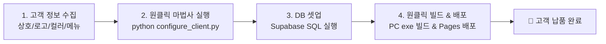

# 💼 외주 개발용 CRM 템플릿 실전 운영 가이드 (Outsourcing Playbook)

> **"새로운 고객사 수주부터 납품까지 단 15분 만에 끝내는 실전 파이프라인"**  
> 본 템플릿은 1인 헤어살롱, 바버샵, 네일/뷰티샵, 필라테스/PT샵, 펫살롱 등 **소규모 예약/방문 기반 매장**을 위한 완성형 풀스택 CRM 보일러플레이트입니다.

---

## 📌 1. 외주 비즈니스 모델 및 수익화 가이드

### 권장 가격 모델
- **기본 납품형 (일회성)**: **50만 ~ 150만원**
  - PC 데스크톱 앱(.exe) + 모바일 웹 시스템 구축 + 기본 메뉴 커스텀
  - Supabase / Cloudflare 무료 티어로 고객 계정 소유권 완전 이전 (유지비 0원)
- **월 유지보수형 (정기 구독)**: **초기 30만 ~ 50만원 + 월 1.5만 ~ 3만원**
  - 내 에이전시 인프라에서 호스팅 대행 + 매월 데이터 백업 + 우선 기술 지원
  - 10개 고객사 확보 시 **매달 순수익 15~30만원**의 지속적인 MRR(월 정기 매출) 창출

---

## ⚡ 2. 신규 외주 건 수주 시 4단계 납품 파이프라인 (소요시간 15분)



### [1단계] 고객 정보 확인 (사전 인터뷰)
고객에게 카카오톡/이메일로 아래 4가지만 전달받습니다:
1. **상호명**: (예: 루나 헤어살롱, 클래식 바버샵)
2. **업종/대표 컬러**: (예: 미용실/인디고, 바버샵/모던블랙, 네일샵/로즈핑크)
3. **원장님 이메일**: 관리자 로그인용 이메일
4. **대표 시술/서비스 메뉴 5~10개**: (예: 남성컷, 볼륨매직, 전체염색 등)

---

### [2단계] 원클릭 설정 마법사 실행 (`configure_client.py`)
터미널에서 명령어 한 줄을 실행하고 안내에 따라 입력합니다:
```bash
python configure_client.py
```
- 업종 프리셋(미용실, 바버샵, 네일샵, 필라테스, 펫살롱 등)을 선택하면 알맞은 이모지와 색상, 메뉴가 자동 추천됩니다.
- 입력이 끝나면 아래 파일들이 **1초 만에 일괄 갱신**됩니다:
  - `client_config.json` (중앙 브랜드 메타데이터)
  - `desktop/client_config.json` & `desktop/.env`
  - `web/client_config.json` & `web/.env.local`
  - `supabase/setup_new_client.sql` (해당 고객사 전용 DB 스키마)

---

### [3단계] Supabase 데이터베이스 셋업 (2분)
1. [Supabase 대시보드](https://supabase.com/dashboard)에서 신규 프로젝트 생성 (`New project`)
2. 좌측 메뉴 **`SQL Editor`** 클릭
3. 이번 단계에서 자동 생성된 `supabase/setup_new_client.sql` 파일 내용을 그대로 복사하여 붙여넣고 **`Run`** 실행!
4. **끝!** (고객/시술 테이블, 인덱스, RLS 보안, 관리자 전용 가입 잠금 트리거가 한 번에 완성됩니다.)

---

### [4단계] 빌드 & 배포 (5분)

#### ① PC 데스크톱 앱 빌드 (.exe 생성)
```bash
cd desktop
build_exe.bat
```
- 빌드가 완료되면 `desktop/dist/` 폴더 안에 고객사 전용 브랜드 컬러와 이름이 적용된 **`MiniSalon.exe`** 파일이 완성됩니다.
- 이 파일 하나만 압축해서 고객에게 카톡/메일로 전달하면 끝입니다.

#### ② 모바일 / 웹 클라이언트 배포
```bash
cd web
npm run build
npx wrangler pages deploy out --project-name=<고객상호영문> --branch=master
```
- 단 30초 만에 `https://<고객상호영문>.pages.dev` 주소로 전 세계 엣지에 초고속 배포됩니다.

---

## 📋 3. 고객 계정 소유권 이전 (Transfer) 가이드

외주 개발 종료 후 내 무료 계정 한도를 비우고 고객 계정으로 완전히 넘겨주는 방법입니다:

### 1) Supabase 프로젝트 이전
1. 고객에게 Supabase에 구글 간편가입을 하도록 요청합니다.
2. 내 Supabase 프로젝트 대시보드 접속 -> **`Settings (톱니바퀴)`** -> **`General`**
3. 화면 최하단 **`Transfer project`** 클릭
4. 고객의 Supabase 계정(이메일 또는 Organization)을 선택하여 이전 요청을 보냅니다.
5. 고객이 수락하면 내 무료 한도는 즉시 반환되며, 소유권과 데이터베이스가 고객 계정으로 안전하게 귀속됩니다.

### 2) 커스텀 도메인 연결 (고객 도메인이 있을 경우)
고객이 `www.mysalon.co.kr` 같은 자체 도메인을 원할 경우:
1. Cloudflare Pages 대시보드 접속 -> 해당 프로젝트 선택
2. **`Custom domains`** 탭 클릭 -> **`Set up a custom domain`** 클릭
3. 고객 도메인 입력 후 Cloudflare 안내에 따라 DNS CNAME 레코드 1줄만 추가하면 1분 안에 무료 SSL 보안 인증서와 함께 연결 완료!

---

## 💌 4. 고객 납품 시 함께 전달하는 [1분 사용 매뉴얼] 템플릿

*(아래 내용을 복사하여 고객에게 카카오톡이나 노션으로 전달하세요)*

```markdown
안녕하세요 원장님! 의뢰해주신 [상호명] 전용 매장 관리 시스템 구축이 완료되었습니다.

1. PC 매장 관리 프로그램 (데스크톱 앱)
- 첨부해드린 [상호명_매장관리.exe] 파일을 PC 바탕화면에 저장 후 더블 클릭하시면 바로 실행됩니다.
- 최초 1회 로그인 후에는 프로그램이 로그인 상태를 기억하므로 매번 비밀번호를 입력할 필요가 없습니다.
- 새로운 버전이 출시되면 프로그램 시작 시 '원클릭 자동 업데이트'가 제공됩니다.

2. 스마트폰 / 태블릿 관리 (모바일 웹)
- 접속 주소: https://[고객상호].pages.dev
- 스마트폰 브라우저(사파리/크롬)로 접속하신 후 [홈 화면에 추가]를 누르시면 일반 앱처럼 홈 화면 아이콘으로 편하게 쓰실 수 있습니다.

3. 관리자 로그인 정보
- 아이디: [원장님 이메일]
- 초기 비밀번호: [임시 비밀번호] (로그인 후 비밀번호 변경 가능)
* 보안을 위해 원장님 이메일 외 다른 사람의 신규 회원가입은 데이터베이스 차원에서 원천 차단되어 있습니다.
```

---

## 🛠️ 5. 업종별 템플릿 프리셋 요약표

| 프리셋 번호 | 업종 | 대표 아이콘 | 기본 추천 컬러 | 주요 시술/이용 항목 |
| :---: | :--- | :---: | :--- | :--- |
| **1** | 헤어살롱 / 미용실 | ✂️ | 인디고 (`#4f46e5`) | 컷, 펌, 매직, 염색, 클리닉, 스캘프케어 |
| **2** | 바버샵 / 맨즈헤어 | 💈 | 모던 슬레이트 (`#0f172a`) | 바버컷, 포마드쉐이빙, 다운펌, 라인정리 |
| **3** | 네일샵 / 에스테틱 | 💅 | 로즈핑크 (`#e11d48`) | 젤네일, 이달의아트, 젤패디, 쏙오프, 속눈썹펌 |
| **4** | 필라테스 / PT샵 | 🏃 | 에메랄드 (`#059669`) | 1:1 개인레슨, 듀엣레슨, 체형분석, 세션이용권 |
| **5** | 반려동물 펫살롱 | 🐾 | 웜 앰버 (`#d97706`) | 소형견목욕, 전체미용, 가위컷, 스파탄산입욕 |
| **6** | 커스텀 직접입력 | 자유 | 직접 HEX 입력 | 자유롭게 쉼표로 나열 |
